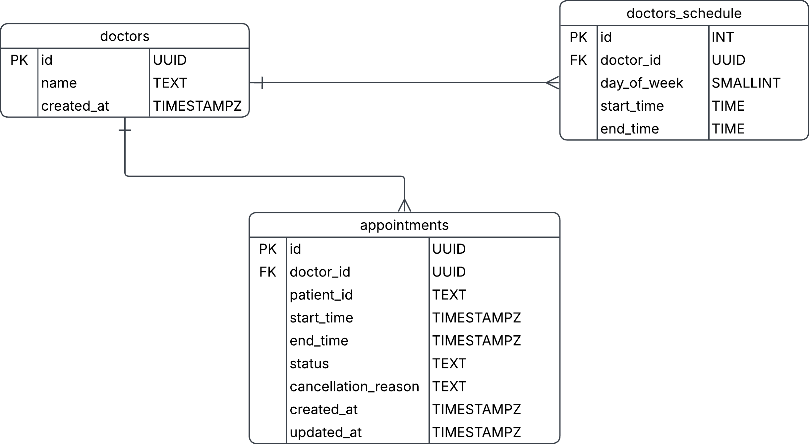
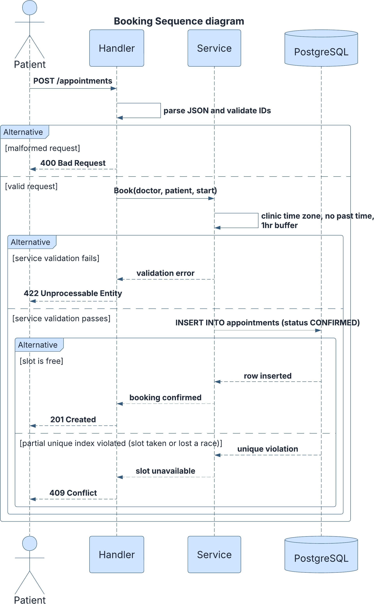
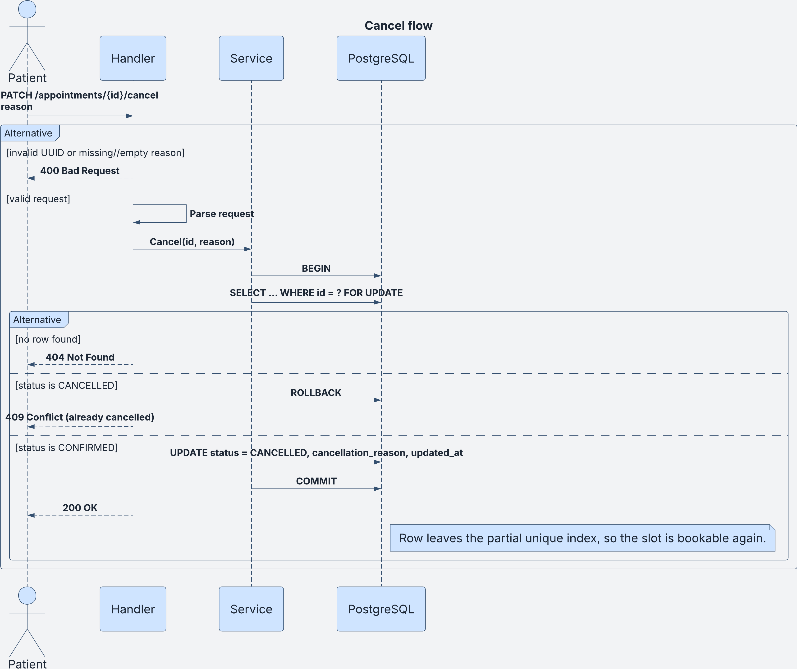

# Clinic Booking API

REST API for a small clinic (5 doctors, 30-minute slots) built with Go and PostgreSQL.
Patients can view a doctor's free slots for a date, book one, cancel, and reschedule.

- **Live URL:** https://clinic-booking-yrt8.onrender.com (health check: `/healthz`)
- **Deploys from:** `main`, automatically, after the tests pass (see [CI/CD](#6-cicd))

> The live service runs on free tiers. The first request after a period of inactivity can take
> several seconds while the service wakes up, and the free database is deleted on
> **21 November 2026** unless it is upgraded.

---

## 1. System design

### Scope and growth
Starting scope is one clinic and a handful of doctors, but the design should not need a rewrite
to grow. The workload is **read-heavy** (many availability lookups, few bookings), and the one
hard correctness requirement is that **a slot can never be booked twice**.

### Components
```text
Client -> HTTP handlers -> Service (rules, slot math) -> Repository (SQL, tx) -> PostgreSQL
```
- **Handlers:** routing, JSON decoding, status-code mapping. No business rules.
- **Service:** validation, slot generation, clinic time zone handling, the booking policy.
- **Repository:** SQL and transactions; translates DB errors (e.g. unique violation) into domain errors.
- **Modular monolith, stateless:** one deployable, easy to scale horizontally behind a load balancer.
  Microservices would add cost with no benefit at this size.

### Data model
| Table | Purpose |
| --- | --- |
| `doctors` | `id UUID`, `name`, `created_at` |
| `doctor_schedules` | recurring weekly shifts: `id` (`integer`, identity), `doctor_id`, `day_of_week` (`smallint`, 0=Sun), `start_time`, `end_time` (clinic-local `TIME`) |
| `appointments` | `id UUID`, `doctor_id`, `patient_id` (opaque external ID, `TEXT`), `start_time`, `end_time` (`TIMESTAMPTZ`), `status`, `cancellation_reason`, `late_cancellation` (`BOOLEAN`, default false), `created_at`, `updated_at` (all strings are `TEXT`) |

**Patients are not defined in a table.** `patient_id` is an opaque identifier supplied by the caller.



Constraints worth noting:
- `status` is restricted by a `CHECK` (`CONFIRMED`, `CANCELLED`).
- `CHECK (day_of_week BETWEEN 0 AND 6)` on shifts.
- `cancellation_reason` is required when `CANCELLED` and null when `CONFIRMED` (a `CHECK` ties it to `status`).
- `late_cancellation` is `NOT NULL DEFAULT false` and can only be true when `status = 'CANCELLED'`.
- `CHECK (end_time > start_time)` on both shifts and appointments.
- `idx_appointments_patient_start ON appointments (patient_id, start_time)` supports the patient listing endpoint.
- A doctor may have several shifts per day (e.g. a lunch break) but they must not overlap.

### Key decisions

**Double-booking prevention is enforced by the database.**
```sql
CREATE UNIQUE INDEX uniq_active_slot
ON appointments (doctor_id, start_time) WHERE status = 'CONFIRMED';
```
The service checks first (for a friendly error), but the index is the source of truth, so two
concurrent requests cannot both succeed. The loser gets a unique violation, returned as `409`.
Cancelled rows are excluded from the index, so cancelling frees the slot.

**A patient cannot hold overlapping appointments.** The same pattern, keyed by patient:
```sql
CREATE UNIQUE INDEX uniq_patient_slot
ON appointments (patient_id, start_time) WHERE status = 'CONFIRMED';
```
Because every start time sits on the same 30-minute grid, two appointments can only overlap if
they start at the same instant, so this index is sufficient. A patient booking two doctors at the
same time gets a `409`. The rule also applies to reschedule.

*Alternative considered:* an exclusion constraint on `tstzrange(start_time, end_time)` using
`btree_gist`, which prevents any overlap, not just identical starts. The unique index is simpler
and sufficient **because the service only accepts start times aligned to the 30-minute grid**.

**Availability is computed on read**, from the doctor's shifts minus confirmed appointments,
rather than stored as slot rows. No background jobs, no stale data, schedule changes apply
immediately. Trade-off: slightly more work per request and no per-slot metadata. If read load
grows, cache the result per `(doctor, date)` and invalidate on booking.

**Cancellation is a status change, not a delete**, so history and reasons are preserved.
A cancellation made **within 1 hour of the start time is allowed but flagged** with
`late_cancellation = true`. The slot is still released, but the clinic keeps an accurate record of
last-minute cancellations instead of a "confirmed" booking that everyone knows will be missed. The
flag is computed by the service from the clinic clock at the moment of cancellation, never taken
from the request.

**Reschedule is a single transaction:** lock the appointment row, validate the new slot like a
fresh booking, update in place. The request may include an optional `doctor_id` to move the
appointment to a different doctor (it defaults to the current doctor), and the new slot is
validated against that doctor's schedule. If the new slot is taken, or the patient already has an
appointment at that time, the transaction fails and the original booking is untouched. If you want to reschedule an appointment that starts within 1hr you have the option of cancelling the appointment taht will attract the `late_cancellation` flag and book a new appointment.

**Time zone is fixed to `Africa/Nairobi` (UTC+03:00).** Shifts are clinic-local wall-clock times;
appointments are stored as UTC instants. The zone is a constant in the service, not a setting, and
"a date" always means that date in Nairobi. Growth path: move the zone to a per-clinic column if more clinics are added.

### Assumptions
- Slots are 30 minutes and aligned to the shift start. Misaligned start times are rejected.
- A booking must start at least **1 hour** from now (also applies to reschedule). Past slots are rejected.
- Cancellation reason is required: trimmed, non-empty, max 500 characters (400 if missing), and enforced by a `CHECK` constraint.
- Cancelling within 1 hour of the start is **allowed and flagged** as a late cancellation. The
  response includes `late_cancellation`.
- An appointment that has **already started** cannot be cancelled or rescheduled (422).
- An appointment starting **within 1 hour cannot be rescheduled** (422). Otherwise a reschedule
  could be used to avoid the late-cancellation flag.
- Reschedule may change the time and also have the option to change the doctor.
- A patient cannot hold two confirmed appointments at the same time, even with different doctors (409).
- Patients are identified by a caller-supplied ID; there is no patient registration.
- No authentication, so any caller can act on any `patient_id`.

### Error contract
| Status | When |
| --- | --- |
| 400 | malformed JSON, bad UUID, bad `patient_id` format, or bad date format |
| 404 | doctor (including a reschedule target doctor) or appointment not found |
| 409 | slot already taken; patient already has an appointment at that time; appointment already cancelled |
| 422 | outside working hours, misaligned slot, in the past or inside the 1-hour buffer; rescheduling within 1 hour of the start; cancelling or rescheduling an appointment that has already started |

### Diagrams

**Booking flow** (including the race-condition path)



**Cancel flow**



**Reschedule flow** (single transaction)


### Trade-offs and growth path
- No cache like Redis which in this version wouldbe over-engineering (Postgres handles indexed range queries at this scale).
- Rate limiting: Not implemented in this version.


---

## 2. API
 
| Method | Path | Description |
| --- | --- | --- |
| GET | `/healthz` | Liveness and database check |
| POST | `/appointments` | Book a slot |
| GET | `/doctors/{id}/availability?date=YYYY-MM-DD` | Free slots for a doctor on a date |
| PATCH | `/appointments/{id}/cancel` | Cancel with a reason; flags `late_cancellation` within 1 hour of the start |
| PATCH | `/appointments/{id}/reschedule` | Move to a new slot, optionally with a different doctor |
| GET | `/patients/{id}/appointments` | Upcoming appointments, sorted by start time (bonus) |
 
Times are RFC 3339 with an offset (for example `2026-10-28T10:00:00+03:00`) and are returned in
clinic time. Seeded doctor IDs run from `11111111-1111-4111-8111-111111111111` to
`55555555-5555-4555-8555-555555555555`.
 
**Book**
```bash
curl -X POST https://clinic-booking-yrt8.onrender.com/appointments \
  -H 'Content-Type: application/json' \
  -d '{"doctor_id":"11111111-1111-4111-8111-111111111111","patient_id":"patient-1","start_time":"2026-10-28T10:00:00+03:00"}'
```
```json
{
  "id": "1c10adb4-df0c-4c19-98ba-1705cf60c390",
  "doctor_id": "11111111-1111-4111-8111-111111111111",
  "patient_id": "patient-1",
  "start_time": "2026-10-28T10:00:00+03:00",
  "end_time": "2026-10-28T10:30:00+03:00",
  "status": "CONFIRMED",
  "cancellation_reason": null,
  "late_cancellation": false
}
```
Booking the same slot again returns `409` with `{"error":"this slot is already booked"}`.
 
**Availability**
```bash
curl "https://clinic-booking-yrt8.onrender.com/doctors/11111111-1111-4111-8111-111111111111/availability?date=2026-10-28"
```
```json
{
  "doctor_id": "11111111-1111-4111-8111-111111111111",
  "date": "2026-10-28",
  "slots": [
    {"start": "2026-10-28T08:00:00+03:00", "end": "2026-10-28T08:30:00+03:00"}
  ]
}
```
(the real response lists every free slot for the day.)
 
**Cancel**
```bash
curl -X PATCH https://clinic-booking-yrt8.onrender.com/appointments/<id>/cancel \
  -H 'Content-Type: application/json' -d '{"reason":"feeling unwell"}'
```
Returns `200` with the appointment: `"status":"CANCELLED"`, the stored reason, and `late_cancellation`.
Cancelling again returns `409`.
 
**Reschedule** (`doctor_id` is optional; leave it out to keep the current doctor)
```bash
curl -X PATCH https://clinic-booking-yrt8.onrender.com/appointments/<id>/reschedule \
  -H 'Content-Type: application/json' \
  -d '{"start_time":"2026-10-28T11:00:00+03:00","doctor_id":"22222222-2222-4222-8222-222222222222"}'
```
Returns `200` with the moved appointment.
 
**Patient's upcoming appointments**
```bash
curl https://clinic-booking-yrt8.onrender.com/patients/patient-1/appointments
```
```json
{"patient_id": "patient-1", "appointments": []}
```
The list is sorted by start time and excludes cancelled and past appointments. A patient with none, including an
ID that has never booked, gets an empty list.
 
---

## 3. Run locally
 
Requirements: Go (version in `go.mod`), Docker, and `make`.
 
```bash
cp .env.example .env     # PORT, DATABASE_URL, POSTGRES_* for the local database
docker compose up -d db  # PostgreSQL 16 on localhost:5432
make run                 # applies migrations on startup, then serves on :8080
make seed                # in a second terminal: loads the 5 doctors and their shifts
```
 
Then try it:
```bash
curl localhost:8080/healthz
curl "localhost:8080/doctors/11111111-1111-4111-8111-111111111111/availability?date=2026-10-28"
```
 
Configuration is read from environment variables: `DATABASE_URL` (required) and `PORT` (default `8080`).
`make migrate-up` and `make migrate-down` use the golang-migrate CLI if you want to run migrations by hand.
 
## 4. Tests
 
```bash
make test        # go test ./... -race -count=1, with .env loaded
```
Rule and service tests use an injected clock and a fake repository, so they need no database. The repository,
migration and concurrency tests run against a real PostgreSQL through `DATABASE_URL` and are skipped when it is
not set, so always run them through `make test` or with `DATABASE_URL` exported.
 
Covers: happy path, outside working hours, misaligned slot, past slot, 1hr buffer, slot taken, cancel twice,
late cancellation flag and its exact boundary, cancel or reschedule an appointment that already started,
reschedule a cancelled appointment, reschedule into a taken slot, reschedule to a different doctor, patient
overlap (booking and reschedule), rollback leaving the original booking intact, upcoming-appointments filtering
and ordering, HTTP error mapping for every endpoint, migrations that are safe to repeat, and concurrent
double-booking, cancel and reschedule tests against real Postgres.

## 5. Deployment
 
- **Host:** Render. A Web Service built from the repository `Dockerfile` (multi-stage build, static binary,
  distroless non-root image) plus a Render PostgreSQL 16 database in the same region (Oregon), connected over
  Render's private network.
- **Configuration:** `DATABASE_URL` is set in the service's environment (the database's internal URL); `PORT` is
  provided by Render. Secrets are never committed: `.env` is ignored by git and the Docker build.
- **Health check:** `/healthz`, which also pings the database. A new version that fails it never receives traffic.
- **Migrations:** applied by the application on startup.
- **Seed data:** the doctors and shifts in `seed/seed.sql` were loaded once with `psql` (the file is idempotent).
- **Auto-deploy is off in Render.** Deploys happen only through the pipeline, after the tests pass.
- **Limits:** free tier. The service sleeps when idle, and the free database is deleted on 21 November 2026.

## 6. CI/CD
 
GitHub Actions, one workflow (`.github/workflows/ci.yml`):
 
- **On every pull request:** the `test` job starts a PostgreSQL 16 service container, then runs `go vet`,
  `go build`, applies the migrations with the same code the server runs at startup, and runs `go test -race`.
- **On merge to `main`** (the deploy branch): the same `test` job runs, and if it passes the `deploy` job calls
  the Render deploy hook, a secret stored as the `RENDER_DEPLOY_HOOK_URL` repository secret. Render builds the
  Dockerfile and starts the new version only if it passes its health check. Deploys never run concurrently.
- Pull requests never deploy and a failing test blocks the deploy.
---

## 7. Reflection: how I used AI
TODO.